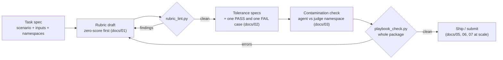

# LLM Evaluation Playbook

[](https://github.com/Zhi-Chao-PAN/llm-evaluation-playbook/actions/workflows/ci.yml)

A field-tested playbook for designing LLM evaluation tasks — three-tier rubrics, machine-checkable tolerances, contamination control, and large-scale feedback quality management.

Distilled from ~6 months of hands-on freelance work designing evaluation tasks for frontier LLM / agent products (30+ evaluation batches; 23k+ valid human-feedback items produced in a peak month at 99.1% validity). All examples in this repo are **synthetic** — no client data, prompts, or rubrics are reproduced here.

## Why this exists

Most evaluation tasks fail for boring, preventable reasons:

| Failure | Symptom | Root cause |
|---|---|---|
| Vague rubric | Two reviewers score the same answer 3 and 8 | "Reasonably accurate" is not a criterion |
| Numeric chaos | Correct answer marked wrong | Single expected value, no tolerance band, unit confusion |
| Contamination | Model "aces" tasks it should fail | Reference answers leaked into the agent context |
| Multi-turn drift | Turn-3 scores are noise | Prior-turn outputs never frozen, so later turns have no stable baseline |
| Feedback soup | 20k feedback items, 60% unusable | No validity taxonomy, no spot-check process |

Each chapter in [`docs/`](docs/) attacks one of these with concrete patterns, and [`tools/`](tools/) turns the two highest-leverage patterns into runnable checks.

## Core principles

1. **Verifiable > vibes.** If a criterion cannot be checked by a script or a second reviewer without arguing, it is not a criterion yet.
2. **Machine-checkable first.** Numeric and set-membership criteria get automated bands; prose judgment is the fallback, not the default.
3. **Isolation by default.** Reference answers and rubrics live in the judge namespace. The agent sees only what a real user would see.
4. **Define zero before defining excellence.** A rubric that cannot say what a worthless answer looks like will inflate scores.
5. **Freeze the past.** In multi-turn tasks, later turns are scored against frozen canonical prior outputs — not against whatever the model happened to say earlier.

## Repo map

```
docs/
  01-rubric-design.md          Three-tier constraint rubrics + zero-score criteria
  02-numeric-tolerances.md     Machine-checkable scoring bands (absolute / pp / interval)
  03-contamination-control.md  Reference-answer isolation & attachment visibility
  04-multi-turn-design.md      Canonical prior outputs, curveball turns, re-baselining
  05-feedback-quality.md       Validity taxonomy + process for 10k+ item/month feedback
  06-long-horizon-agents.md    Checkpoint rubrics for long-running agent tasks
  07-llm-as-judge.md           Tiered arbitration, judge failure modes, calibration
templates/
  task-spec-template.md        Fillable task specification
  rubric-template.md           Fillable three-tier rubric
  submission-checklist.md      Pre-submission QA checklist (the one I actually use)
tools/
  playbook_check.py            One-shot validator for a whole task package
  rubric_lint.py               Flags vague, unscoreable language in rubrics
  tolerance_check.py           Validates numeric answers against tolerance specs
  test_tools.py                Unit tests for all three tools
examples/
  synthetic-saas-analysis/     A fictional end-to-end package: spec, rubric,
                               reference answer, data CSVs, tolerance specs,
                               and demo answers (passes playbook_check)
```

## How the pieces fit



## Quickstart

```bash
# One-shot validation of a complete task package
python tools/playbook_check.py examples/synthetic-saas-analysis

# Lint a rubric draft for vague language
python tools/rubric_lint.py templates/rubric-template.md

# Check a numeric answer against a tolerance spec
python tools/tolerance_check.py --expected 4817500 \
  --spec '{"type":"relative","value":0.02}' --answer 4890000

# Batch mode (one JSON object per line) — see the demo answers in the example
cat examples/synthetic-saas-analysis/answers_demo.jsonl | python tools/tolerance_check.py --batch

# Run the test suite
python tools/test_tools.py
```

No third-party dependencies — Python 3.8+ standard library only.

Tolerance specifications require finite numeric bounds, non-negative tolerances,
and ordered intervals (`low <= high`). Booleans, NaN and infinity are rejected.
The CLI returns `0` for a pass, `1` for a valid comparison outside the band, and
`2` for invalid input/specifications (including an empty batch). Batch mode
reports malformed rows and continues checking subsequent records; any input
error makes the overall exit status `2`.

## Lessons learned (short version)

- The rubric is the product. Reviewers argue less when hard constraints are binary and soft constraints carry explicit weights.
- "Percentage points" and "percent" destroy more score sheets than any model error. Always write `pp` explicitly.
- A model will satisfy the letter of a rubric if the letter is weaker than the spirit. Paraphrase-attack your own criteria before shipping them.
- Long-horizon agents fail at checkpoints, not at the end. Score the checkpoints.
- Feedback validity is a process metric: track it daily, per module, and keep the rejected samples — they are the training set for your own judgment.

## License

[MIT](LICENSE)
